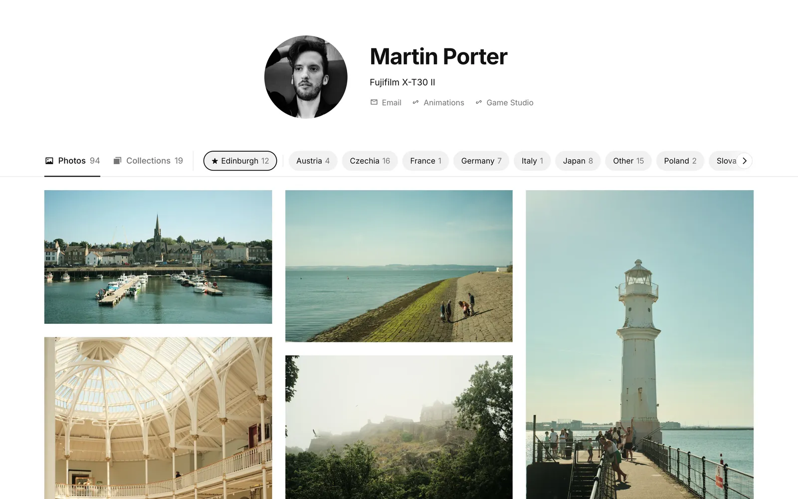
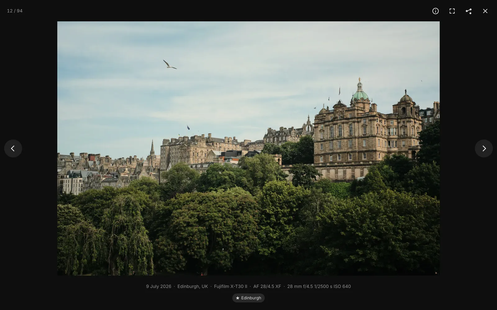
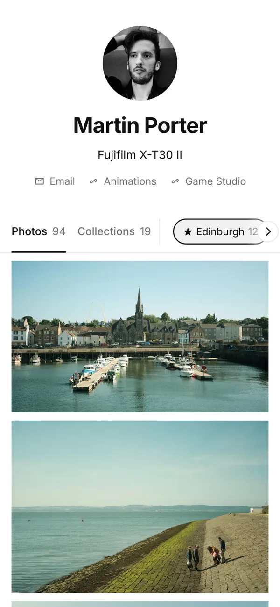
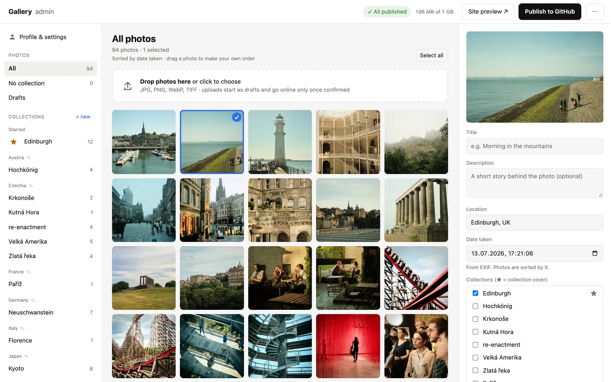
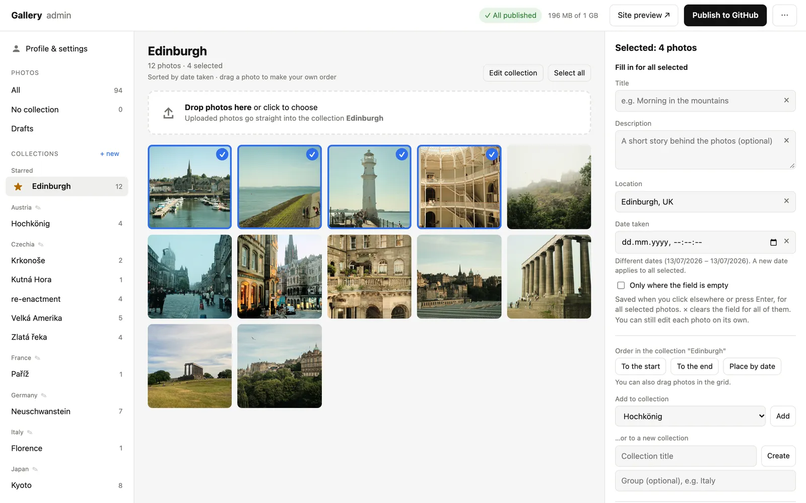

# Photo Gallery

A self-hosted photo gallery in the style of Unsplash. The public site is plain static HTML that
GitHub Pages serves for free; you manage it from a small admin that runs on your own computer.
Drop photos in, write titles and descriptions, sort them into collections, click **Publish**.

No database, no build tools, no tracking by default. Two npm dependencies.

**Live demo:** [martinposta.github.io/photo-gallery](https://martinposta.github.io/photo-gallery/), a gallery
of generated placeholder images. Click around: collections, groups, the lightbox, arrow keys, swipe.

**In real use:** [foto.martinposta.com](https://foto.martinposta.com), the author's own gallery built with it.



<p>
  
  
</p>

The admin: edit one photo, or many at once.




## How it's designed

The admin was designed as a **local app for your PC or Mac**. You run it on your own computer, and
**Publish** commits the gallery straight to your GitHub repository, from which **GitHub Pages**
serves it. No server to maintain, no database, no hosting bill, and GitHub doubles as the backup.

That is a choice, not a limit. If you would rather run the admin on a home server, publish to another
static host, or add a login and put the admin online, go ahead: the code is MIT-licensed, publishing
lives in one file (`admin/git.mjs`) and the generated site is plain files in `docs/`.

## Features

**Admin (runs locally, `http://localhost:4321`)**

- Drag-and-drop upload. Each photo becomes resized WebP copies (480–2400 px) plus a JPEG for link
  previews. **Your originals never leave your computer.**
- Title, description, location and date are read from the metadata your editor wrote (Lightroom,
  Capture One, Apple Photos, Windows) and can be edited, one photo or many at once.
- Collections, grouped by an optional group (e.g. a country), starred collections listed first,
  a cover photo per collection.
- Automatic order by date taken or upload, or your own order by dragging.
- **Drafts:** new uploads stay private until you confirm them.
- **Replace a photo** with a re-edited version: same address, texts and collections.
- **Preview of changes** before publishing: new photos, edited texts, collections, settings.
- **Several computers:** every admin copy syncs through GitHub, merges edits field by field, and
  can pull the latest state or discard its own changes.
- Repository size indicator against GitHub's recommended 1 GB.

**Public site**

- Masonry grid, collection and group pages, a lightbox with keyboard, swipe and fullscreen.
- Every photo has its own page with Open Graph tags, so shared links get a preview image.
- Responsive images (`srcset`), self-hosted font, no third-party requests.
- **Privacy:** published files carry no metadata from the original (no GPS, no serial numbers).
  They carry only what you choose: author, copyright and a contact for usage requests (EXIF + XMP).
- Optional: contact e-mail (never stored whole in any file), Cloudflare Web Analytics (cookieless),
  custom domain.

## Requirements

- [Node.js](https://nodejs.org) 20.12 or newer
- [Git](https://git-scm.com)
- A GitHub account (for publishing; the admin works without one)

macOS, Windows and Linux work. Image processing uses [sharp](https://sharp.pixelplumbing.com),
whose prebuilt binaries cover all three.

## Try it with placeholder content

```bash
git clone https://github.com/<you>/<this-repo>.git photo-gallery
cd photo-gallery
npm install
npm run demo          # creates ./demo-data with 12 generated gradient "photos"
npm run admin:demo    # opens the admin on it
```

The demo gallery lives in `demo-data/` (ignored by git) and never mixes with your own.
Click **Site preview** to see the public site.

## Set up your own gallery

### 1. Start the admin

```bash
npm install
npm run admin
```

The admin opens in your browser at http://localhost:4321. On macOS you can also double-click
`start.command`, on Windows `start.cmd`. Stop it with `Ctrl+C` or by closing the window.

Open **Profile & settings** and fill in your name, bio, links and copyright. Upload a few photos,
confirm them (**Confirm new photos**) and look at **Site preview**.

### 2. Connect to GitHub

The gallery is a git repository: your content (`data/`) and the generated site (`docs/`) are
committed next to the code, and GitHub Pages serves `docs/`.

1. Create a new **public** repository on GitHub (free Pages needs a public repo), without a README.
2. Point this folder at it:

   ```bash
   git remote set-url origin https://github.com/<you>/<gallery-repo>.git   # if you cloned
   # or, for a fresh folder:
   git init -b main
   git remote add origin https://github.com/<you>/<gallery-repo>.git
   ```

3. Tell git who you are, for this repository only. Use GitHub's **noreply** address
   (GitHub → Settings → Emails) so your personal e-mail does not end up in public commits:

   ```bash
   git config user.name "Your Name"
   git config user.email "<id>+<you>@users.noreply.github.com"
   ```

4. Make sure git can log in to GitHub. On Windows, Git for Windows opens a browser sign-in on the
   first push. On macOS or Linux the easiest way is the [GitHub CLI](https://cli.github.com):
   `gh auth login`, then `gh auth setup-git`.
5. In the admin, click **Publish to GitHub**.
6. On GitHub, open the repository's **Settings → Pages**: *Deploy from a branch*, branch `main`,
   folder **`/docs`**. The site is online within a minute or two.

### 3. Your own address (optional)

- **Subdomain** (e.g. `photos.example.com`): add a DNS record `CNAME photos → <you>.github.io`.
  In **Profile & settings** set *Custom subdomain* to `photos.example.com` and *Public address* to
  `https://photos.example.com/`, then publish. Turn on **Enforce HTTPS** in Settings → Pages once
  GitHub has issued the certificate. (On Cloudflare, keep the record *DNS only*.)
- **Sub-folder** of an existing GitHub Pages domain (e.g. `example.com/photos/`): works
  automatically when that domain is served from your `<you>.github.io` repository. Set *Public
  address* to `https://example.com/photos/`.

The public address is what makes link previews (Messenger, WhatsApp, …) show an image.

### 4. More than one computer

Clone the repository on the other computer, run `git config user.name/user.email` there too, and
start the admin. Each copy pulls from GitHub on start and checks for news every few minutes.
**Publish** merges both sides (edits to different fields of the same photo merge cleanly); the
**⋯** menu next to it can pull the latest state or discard this copy's unpublished changes (they
are kept in a local git ref first). Drafts are not synced: they stay on the computer that made them.

## Configuration

Settings that belong to the gallery (name, links, copyright, analytics, contact) are edited in the
admin and stored in `data/gallery.json`. Settings that belong to the machine come from environment
variables, or from a `.env` file next to `package.json` (copy `.env.example`):

| Variable | Default | Meaning |
|---|---|---|
| `PORT` | `4321` | Port of the local admin |
| `NO_OPEN` | *(empty)* | `1` = do not open a browser window on start |
| `GALLERY_DATA_ROOT` | this folder | Where `data/`, `docs/`, `drafts/` and the git repository live |
| `GALLERY_LOCALE` | `en` | Language for sorting collection and group names (`cs`, `de`, …) |

Image sizes, quality and format (WebP or AVIF) are in `lib/config.mjs`; they apply to new uploads.

## Self-hosting

The public site needs no server of its own: it is static files in `docs/`, served by GitHub Pages.
You can serve `docs/` from any static host instead (Netlify, Cloudflare Pages, nginx, …).

The admin is meant to run **on your own computer**. It listens on `127.0.0.1` only and has **no
login**: do not expose it to a network or the internet. To run it on a home server, reach it
through an SSH tunnel (`ssh -L 4321:localhost:4321 server`) rather than opening the port.

```bash
npm ci
npm run admin          # keep it running with your service manager of choice
```

There is no Docker image yet.

## Development

```bash
npm test               # end-to-end tests against a temporary gallery and a local bare repo
npm run rebuild        # regenerate docs/ after editing site/
```

The live demo is the `gh-pages` branch of this repository: the generated site of the demo gallery
and nothing else. To rebuild it, generate the demo with its public address and replace the
branch's contents with `demo-data/docs/`:

```bash
DEMO_SITE_URL=https://<you>.github.io/<repo>/ DEMO_REPO_URL=https://github.com/<you>/<repo> npm run demo
```

| What | Where |
|---|---|
| Public site look | `site/style.css`, `site/app.js`, `site/index.html`, then `npm run rebuild` |
| Admin UI | `admin/public/` |
| Image pipeline, metadata | `lib/images.mjs`, `lib/config.mjs` |
| Site generator | `lib/build.mjs` |
| Git, publishing, sync | `admin/git.mjs`, `lib/merge.mjs` |

```
admin/       local admin: server + UI (never published)
lib/         image processing, data store, site generator
site/        public site template, script, styles, font
scripts/     demo gallery
tests/       npm test
data/        your gallery's texts, collections, settings   (created on first start)
docs/        GENERATED public site, served by GitHub Pages (created on first start)
```

## Limits

- GitHub recommends repositories under **1 GB**. A photo takes roughly 0.5–1.5 MB on the site, so
  that is about 700–1500 photos. Deleted and replaced photos stay in the git history.
- HEIC is not supported by sharp's prebuilt binaries; export JPEG.

## License

The code is released under the [MIT License](LICENSE). Third-party components keep their own
licenses, see [THIRD-PARTY-NOTICES.md](THIRD-PARTY-NOTICES.md).

The author's name, photos and branding are not part of the license. That includes the screenshots in
`screenshots/`, which show the author's own photographs (all rights reserved).
